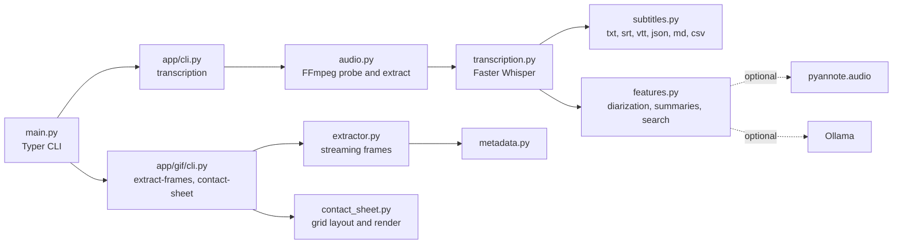

# Video Transcriber

A local media toolkit with three tools behind one CLI:

1. **Transcription**: transcribe video or audio with [Faster Whisper](https://github.com/SYSTRAN/faster-whisper) and write `txt`, `srt`, `vtt`, and `json`, with optional Markdown, CSV, speaker diarization, summaries, silence detection, and transcript search.
2. **GIF frame extraction**: extract every frame of an animated GIF as lossless images with a `metadata.json`.
3. **Contact sheet**: combine extracted frames into one grid image so a vision model can analyse a whole animation from a single picture.

Everything runs on your machine. No cloud services or API keys are required.

```bash
python main.py transcribe      meeting.mp4 --model large-v3
python main.py extract-frames  animation.gif --format png
python main.py contact-sheet   output/animation --labels --timestamps
```

The dedicated scripts `transcribe.py`, `extract_frames.py`, and `contact_sheet.py` can also be run directly.

## Features

- Video (`.mp4`, `.mkv`, `.mov`, `.webm`, and more) and audio (`.mp3`, `.wav`, `.m4a`, `.flac`, and more) input
- Audio extraction to 16 kHz mono via FFmpeg
- Whisper models `tiny`, `base`, `small`, `medium`, `large-v3`
- GPU auto-detection with CPU fallback
- Batch mode with recursive folders and skip-already-done
- Language auto-detection and word-level timestamps
- Optional speaker diarization (pyannote.audio) and summaries from a local Ollama model
- Progress bars with elapsed time, realtime speed, detected language, and model used
- Streaming GIF extraction (one frame in memory at a time) that preserves transparency and never resizes or recompresses
- `FrameProcessor` hooks for per-frame processing such as OCR or captioning
- Auto-sized near-square contact sheets with optional labels and timestamp overlays

## Architecture



## Tech stack

- Python 3.11+, Typer, Rich, tqdm
- Faster Whisper (CTranslate2), FFmpeg and FFprobe
- Pillow for image processing
- Optional: pyannote.audio, Ollama
- pytest, ruff, mypy

## Getting started

### Prerequisites

- Python 3.11+
- FFmpeg and FFprobe on your `PATH` (`brew install ffmpeg`, `sudo apt install ffmpeg`, or `winget install Gyan.FFmpeg`)
- Optional: an NVIDIA GPU with CUDA for large models

### Install

```bash
python3 -m venv .venv
source .venv/bin/activate        # Windows: .venv\Scripts\activate
pip install -r requirements.txt
pip install -r requirements-optional.txt   # optional: diarization and summaries
```

The first run with a given model downloads its weights from Hugging Face. Later runs are offline.

### Transcription

```bash
python transcribe.py meeting.mp4 --model large-v3 --device auto --language en --output ./output
python transcribe.py ./videos --recursive --skip-existing
python transcribe.py lecture.mov -f txt -f srt -f md -f csv --word-timestamps --silence
python transcribe.py ./output --search "quarterly budget"
python transcribe.py panel.mp4 --diarize --summarize --summary-model llama3.2   # needs HF_TOKEN
```

| Option | Default | Description |
|---|---|---|
| `--model`, `-m` | `base` | `tiny`, `base`, `small`, `medium`, `large-v3` |
| `--language`, `-l` | auto | Force a language code |
| `--output`, `-o` | `./output` | Output directory |
| `--device` | `auto` | `cpu`, `cuda`, or `auto` |
| `--beam-size` | `5` | Beam search width (1 to 20) |
| `--compute-type` | auto | CTranslate2 compute type, e.g. `float16`, `int8` |
| `--format`, `-f` | `txt srt vtt json` | Repeatable, adds `md` and `csv` |
| `--word-timestamps` | off | Per-word timings |
| `--no-vad` | off | Disable voice activity detection filtering |
| `--recursive`, `-r` | off | Recurse into sub-folders |
| `--skip-existing` | off | Skip files that already have a JSON transcript |
| `--diarize` | off | Label speakers (needs `HF_TOKEN` or `--hf-token`) |
| `--summarize` | off | Summarize with a local Ollama model |
| `--summary-model` | `llama3.2` | Ollama model name |
| `--silence` | off | Report silent spans |
| `--search` | | Search existing transcripts instead of transcribing |
| `--verbose`, `-v` | off | Debug logging |

The JSON output contains a `metadata` block (source, language, model, device, durations, realtime factor), an optional `summary`, and `segments` with timings, text, speaker, confidence, and optional words.

### GIF frame extraction

```bash
python main.py extract-frames animation.gif --output ./frames --format png
```

Frames are written to `output/<gif-name>/frame_000001.png` and onward, plus `metadata.json` with dimensions, frame count, duration, fps, loop count, and per-frame timing. See [`samples/metadata.sample.json`](samples/metadata.sample.json). Options: `--prefix`, `--format` (`png`, `jpg`, `webp`), `--overwrite`, `--no-metadata`.

```python
from app.gif import extract_frames
result = extract_frames("animation.gif", output_dir="output", image_format="png")
```

### Contact sheet

```bash
python main.py contact-sheet output/animation --columns 9 --padding 8 --labels --timestamps
```

The grid defaults to `ceil(sqrt(n))` columns. Frames are resized uniformly (default width 180 px) without cropping. Options: `--output`, `--columns`, `--padding`, `--thumbnail-width`, `--labels`, `--timestamps`, `--background` (`white`, `transparent`, or a colour), `--format`.

```python
from app.gif.contact_sheet import generate_contact_sheet
result = generate_contact_sheet(frame_directory="output/animation")
```

### Tests

```bash
pip install pytest
pytest
ruff check . && mypy app   # optional
```

## Project structure

```
.
├── main.py                    unified CLI
├── transcribe.py              transcription entry point
├── extract_frames.py          GIF extraction entry point
├── contact_sheet.py           contact sheet entry point
├── app/
│   ├── cli.py                 transcription CLI and orchestration
│   ├── audio.py               FFmpeg detection, probing, extraction, silence
│   ├── transcription.py       device resolution and Faster Whisper wrapper
│   ├── subtitles.py           output writers
│   ├── features.py            diarization, summaries, search
│   ├── utils.py               logging, errors, formatting
│   └── gif/                   extractor, contact sheet, metadata, CLI
├── samples/                   sample metadata.json
├── output/                    generated files (git-ignored)
└── tests/                     pytest suite
```

## Troubleshooting

| Symptom | Fix |
|---|---|
| FFmpeg not found | Install FFmpeg and reopen the terminal |
| Model download fails | The first run needs internet access to fetch weights |
| Out of memory | Use a smaller model, `--device cpu`, or `--compute-type int8` |
| Slow on CPU | Use `tiny` or `base`, or `--compute-type int8` |
| Diarization errors | Install the optional requirements, accept the pyannote terms, set `HF_TOKEN` |
| Summary errors | Install and run Ollama, then `ollama pull llama3.2` |

## Screenshots

Screenshots coming soon.

## License

MIT. See [LICENSE](LICENSE).
